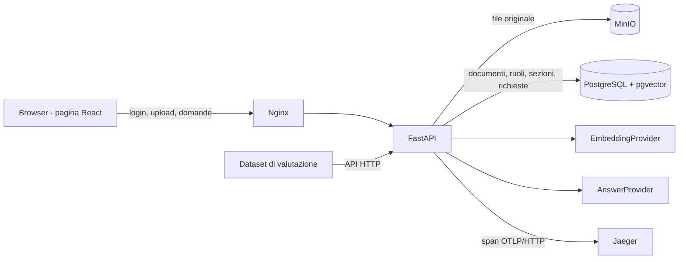

# Enterprise Knowledge Assistant

Demo didattica di un assistente RAG per documenti aziendali **interamente sintetici**. Una sola pagina mostra upload, ricerca, citazioni, astensione, ruoli, stato dell'indicizzazione e statistiche. Il repository è pensato come esempio completo e leggibile, non come servizio pronto per dati reali.

## Cosa dimostra

Il problema è semplice: una risposta su documenti interni deve essere utile **e** verificabile, senza usare informazioni che l'utente non può leggere. Questo progetto percorre l'intera catena, dal file caricato da un amministratore alla frase citata nella risposta. Include anche il caso in cui la risposta corretta è «non posso rispondere».

RAG significa *Retrieval-Augmented Generation*: prima si recuperano passaggi pertinenti da un corpus, poi si produce una risposta vincolata a quei passaggi. Qui la «generazione» è volutamente **estrattiva**: il provider locale restituisce una frase presente nel documento. Non chiama un LLM e non richiede chiavi o API a pagamento. In questo modo permessi, citazioni e astensione restano facili da ispezionare.

La UI è una **single page**: playground, documenti, spiegazione del flusso e pannello amministrativo convivono nella stessa pagina. Il backend è una normale API REST.

## Architettura in un colpo d'occhio



| Tecnologia | Ruolo nel progetto | Dove guardare |
|---|---|---|
| Python 3.12, FastAPI, Pydantic, Uvicorn | API tipizzata, validazione degli input, upload e ciclo di avvio | [`backend/app/main.py`](backend/app/main.py) |
| PostgreSQL 16, psycopg 3 | Documenti, ruoli, sezioni, stati e statistiche con vincoli e transazioni | [`backend/app/storage.py`](backend/app/storage.py) |
| pgvector | Embedding `vector(128)` e ordinamento per distanza coseno | [`backend/app/main.py`](backend/app/main.py) |
| MinIO e MinIO Python SDK | Conservazione degli originali con API compatibile S3 | [`backend/app/storage.py`](backend/app/storage.py) |
| pypdf | Estrazione del testo dai PDF che già contengono testo | [`backend/app/storage.py`](backend/app/storage.py) |
| PyJWT | Token bearer firmati per gli account dimostrativi | [`backend/app/security.py`](backend/app/security.py) |
| React 19, TypeScript, Vite | Stato della singola pagina, form e chiamate API tipizzate | [`frontend/src/App.tsx`](frontend/src/App.tsx) |
| Nginx | Serve la build frontend e inoltra `/api/` al backend | [`frontend/nginx.conf`](frontend/nginx.conf) |
| Docker Compose | Avvio riproducibile, health check, volumi e rete tra servizi | [`compose.yaml`](compose.yaml) |
| OpenTelemetry, OTLP/HTTP, Jaeger | Trace delle fasi RAG senza includere il testo nei relativi attributi | [`backend/app/telemetry.py`](backend/app/telemetry.py) |
| pytest, Ruff, GitHub Actions | Test unitari e di integrazione, lint e CI | [`backend/tests/`](backend/tests/), [`ci.yml`](.github/workflows/ci.yml) |

### Dal caricamento alla risposta

1. **Upload.** L'admin invia file, titolo e ruoli tramite un form multipart. FastAPI verifica ruolo, estensione, dimensione massima di 1 MB e presenza di testo estraibile.
2. **Originale e sezioni.** MinIO riceve il file in una chiave basata su UUID. Il backend legge Markdown/TXT in UTF-8 oppure estrae il testo di un PDF con pypdf. I titoli Markdown diventano ancore di citazione; i paragrafi lunghi vengono spezzati in parti di massimo 900 caratteri.
3. **Indicizzazione.** Ogni sezione viene trasformata in un vettore locale di 128 dimensioni e salvata con `document_id`, ordine, titolo di sezione e contenuto. Lo stato passa da `indexing` a `ready` solo dopo l'inserimento delle sezioni.
4. **Autenticazione e budget.** Un JWT firmato identifica il ruolo. Prima della ricerca l'API controlla numero di richieste nell'ultimo minuto e budget stimato.
5. **Retrieval autorizzato.** La query SQL considera solo documenti `ready` visibili al ruolo (l'admin può ispezionarli tutti), ordina le sezioni per distanza coseno con `<=>` e prende le prime otto.
6. **Risposta fondata.** Il provider locale cerca una frase con sufficiente sovrapposizione di termini rispetto alla domanda. Se la trova, restituisce quella frase e la citazione `documento → sezione`; altrimenti restituisce un'astensione con lista di citazioni vuota.
7. **Misura.** Il backend registra latenza, costo stimato e astensione. Gli span OpenTelemetry separano embedding, retrieval e risposta; il `trace_id` nella risposta permette di trovare la richiesta in Jaeger.

L'ordine dei passaggi conta: il ruolo filtra le **fonti candidate**, quindi una sezione non autorizzata non può finire nel contesto da cui nasce la risposta. Il dettaglio SQL è in [docs/architecture.md](docs/architecture.md).

## Avvio rapido

Richiede Docker con Compose v2. Da questa cartella:

```bash
cp .env.example .env
docker compose up --build -d --wait
```

Apri **http://localhost:5173**. Scegli un ruolo (`employee`, `hr`, `finance`, `admin`) e inserisci la relativa password di `.env`. I valori in `.env.example` sono solo per la demo locale. L'API è su **http://localhost:8000/docs**, la console MinIO su **http://localhost:9001** e i trace su **http://localhost:16686**. I servizi sono esposti solo su `127.0.0.1`.

Al primo avvio vengono importati tre file in `demo/`. L'amministratore può caricare file Markdown, TXT UTF-8 o PDF con testo estraibile, fino a 1 MB. Un PDF scansito senza OCR viene rifiutato.

Per fermare lo stack: `docker compose down`. Per cancellare anche i dati locali: `docker compose down -v`.

### Configurazione

`.env.example` è il modello da copiare; `.env` è escluso da Git. Compose passa le variabili ai container. I valori d'esempio sono pubblici e vanno usati solo sul computer di sviluppo.

| Variabile | A cosa serve |
|---|---|
| `POSTGRES_PASSWORD` | Password del database `knowledge` |
| `MINIO_ROOT_USER`, `MINIO_ROOT_PASSWORD` | Credenziali dello storage S3 locale |
| `JWT_SECRET` | Chiave di firma dei token bearer |
| `ADMIN_PASSWORD`, `HR_PASSWORD`, `FINANCE_PASSWORD`, `EMPLOYEE_PASSWORD` | Password dei quattro account dimostrativi |
| `MAX_REQUESTS_PER_MINUTE` | Numero massimo di domande per account nell'ultimo minuto |
| `MAX_REQUEST_COST_USD`, `MAX_DAILY_COST_USD` | Soglie sul costo stimato di una richiesta e del giorno |
| `ESTIMATED_USD_PER_1K_TOKENS` | Prezzo ipotetico usato per stimare il costo; `0` per la modalità locale |
| `OTEL_EXPORTER_OTLP_ENDPOINT` | Endpoint OTLP/HTTP di Jaeger |

Le porte esposte dall'host sono `5173` (pagina), `8000` (API), `9001` (console MinIO), `16686` (Jaeger) e `5432` (PostgreSQL), tutte legate a `127.0.0.1`. L'API S3 di MinIO (`9000`) resta nella rete Compose.

## Flusso dimostrativo

1. Scegli **Dipendente** e chiedi «Qual è il limite per un hotel per notte?». La risposta deve citare *Trasferte e rimborsi → Pernottamento*.
2. Scegli **Team HR** e chiedi del congedo parentale. La fonte è *Manuale persone → Congedo parentale*.
3. Ripeti la domanda come **Dipendente**: il manuale HR non è visibile e l'assistente si astiene.
4. Scegli **Admin**, carica un documento fittizio, assegna i ruoli e osserva stato, sezioni e statistiche sulla stessa pagina.
5. Apri Jaeger e cerca il servizio `enterprise-knowledge-api`: gli span mostrano ingestione, embedding, retrieval e generazione senza testo di domande o documenti.

Lo script `bash scripts/demo-flow.sh` esegue upload → domanda → statistiche via HTTP e legge le credenziali da `.env`.

## Test e valutazione

Con lo stack avviato:

```bash
docker compose exec -T api pytest -q tests
docker compose exec -T api ruff check app tests
python3 scripts/evaluate.py
```

I test di integrazione verificano upload, indicizzazione, separazione dei ruoli, citazione della sezione e astensione. `demo/questions.json` contiene domande con risposte attese e due casi senza risposta. La valutazione misura:

| Misura | Definizione |
|---|---|
| Correttezza delle citazioni | Risposta contenente il fatto atteso, titolo e sezione corretti, citazione uguale alla frase resa |
| Astensione corretta | Nessuna risposta attribuita né citazione per domande non supportate o fuori permesso |
| Latenza | Media e p95 dei tempi restituiti dall'API |
| Costo stimato | Somma del prezzo configurato per i token stimati; con provider locale il default è $0 |

Il workflow GitHub Actions costruisce lo stack, esegue lint, test e valutazione, mostra i log in caso di errore e rimuove i volumi in ogni caso. I dati dei test sono sintetici. L'output di `evaluate.py` è volutamente leggibile anche senza dashboard: mostra ogni caso, le due frazioni di qualità, media e p95 della latenza, e il costo stimato totale.

## Modello dei dati e pattern applicati

### File originali separati dall'indice

MinIO conserva i byte del file. PostgreSQL conserva ciò che serve per autorizzare, cercare e citare. La tabella `documents` contiene `id`, titolo, nome e chiave dell'oggetto, ruoli e stato; `sections` contiene ordine, titolo, testo ed embedding e ha una foreign key verso il documento. La tabella `requests` contiene soltanto metadati operativi. L'UUID nella chiave MinIO collega originale e record SQL senza affidarsi al nome del file.

Questa separazione evita di trattare il database vettoriale come archivio dei file. Mostra anche un limite reale dei sistemi con due storage: il caricamento su MinIO e la transazione PostgreSQL **non** sono atomici tra loro. Se il database fallisce dopo l'upload, può restare un oggetto orfano. In produzione servirebbero pulizia periodica o un flusso compensativo.

### Repository SQL e vincoli come parte della sicurezza

L'autorizzazione non è soltanto un filtro grafico in React. `current_user` e `admin_user` sono dipendenze FastAPI: proteggono le route prima della logica applicativa. Anche la lettura di un documento per ID ricontrolla il ruolo. Per la ricerca, il predicato è nella query al database:

```sql
SELECT s.document_id, d.title, s.heading, s.content
FROM sections AS s
JOIN documents AS d ON d.id = s.document_id
WHERE d.status = 'ready'
  AND (:role = ANY(d.roles) OR :role = 'admin')
ORDER BY s.embedding <=> :question_vector
LIMIT 8;
```

Il frammento mostra la logica; il codice usa parametri `%s` di psycopg, non interpola valori dell'utente nella stringa SQL. `<=>` è la distanza coseno di pgvector: minore significa più vicino. La query usa una ricerca **esatta**; non c'è un indice ANN/HNSW, perché il corpus dimostrativo è piccolo e la semantica dei permessi resta leggibile. Lo schema include un indice GIN su `roles`, ma la forma attuale del predicato `= ANY(...)` non presuppone che il planner lo utilizzi. Su dati grandi occorrerebbe misurare piano di esecuzione, recall e costo di un eventuale indice approssimato.

Le foreign key impediscono sezioni senza documento; le transazioni fanno sì che sezioni e stato `ready` siano aggiornati insieme. Se l'indicizzazione fallisce, il documento passa a `failed` in una nuova transazione. Lo schema e il bucket vengono creati all'avvio solo se assenti; i documenti demo vengono caricati quando la tabella è vuota.

### Porte per embedding e risposte

`EmbeddingProvider` e `AnswerProvider` sono `Protocol` Python. Il codice di ingestione e la route `/api/ask` dipendono da quelle interfacce; le istanze concrete sono collegate in [`backend/app/rag.py`](backend/app/rag.py). È il pattern **ports and adapters** in forma ridotta: per collegare un provider LLM si implementa un nuovo adapter e si cambia il punto di composizione, mantenendo invariati contratto HTTP, modello dati e filtro dei ruoli.

Il provider demo `HashEmbedding` normalizza le parole, rimuove alcune stopword, assegna ogni termine a una posizione firmata tramite SHA-256 e normalizza il vettore. Documenti e domande condividono così lo stesso spazio a 128 dimensioni. È *feature hashing*, non un embedding semantico addestrato: parole diverse ma sinonime non diventano necessariamente vicine. La dimensione è parte dello schema `vector(128)`; cambiare provider o dimensione richiede reindicizzare le sezioni.

`ExtractiveAnswer` confronta i termini della domanda con le frasi delle sezioni recuperate. Richiede almeno due termini in comune quando la domanda lo consente e una copertura minima del 55%. Se una frase supera la soglia, **risposta e citazione riportano la stessa frase**; se nessuna la supera, restituisce «Non posso rispondere con le fonti disponibili» e nessuna citazione. Questa è una semplice regola di *grounding* e astensione, non una garanzia generale contro risposte errate.

### Autenticazione dimostrativa e RBAC

`/api/login` riceve username e password tramite il form previsto da FastAPI per il password flow e rilascia un JWT HS256 valido otto ore. Il token contiene utente, ruolo e scadenza. L'app usa quattro account fissi (`admin`, `hr`, `finance`, `employee`), con password e chiave di firma lette da variabili d'ambiente. È una dimostrazione del **role-based access control** (RBAC), non un identity provider OAuth2 aziendale. L'admin può caricare, consultare tutti i documenti e leggere le statistiche; gli altri ruoli vedono soltanto i documenti loro assegnati.

Il frontend non conserva password nel codice. La selezione di un nuovo ruolo azzera la sessione locale e chiede una nuova autenticazione. Le API effettuano sempre la verifica effettiva: nascondere un pulsante nella pagina non concede né revoca accesso.

### Single page con stato esplicito

React mantiene nello stato la sessione, il ruolo scelto, la domanda, la risposta, i documenti visibili, le statistiche e gli errori. Gli input sono controllati; login, upload e domanda inviano richieste dai rispettivi event handler. TypeScript descrive le risposte API (`Answer`, `Citation`, `Document`, `Stats`) e aiuta a mantenere coerente la UI. Vite compila il frontend; Nginx serve i file statici e fa da reverse proxy per `/api/`. Non serve un router: anche la vista admin è una sezione della stessa pagina.

### Osservabilità senza contenuti

OpenTelemetry crea span manuali per `document.ingest`, `rag.answer`, `rag.embed`, `rag.retrieve` e `rag.generate`. `TracerProvider`, `BatchSpanProcessor` ed exporter OTLP/HTTP spediscono i trace a Jaeger. Gli attributi sono conteggi, dimensioni, ruolo e stato di astensione; domande, risposte e testo dei documenti non vengono aggiunti agli span. Il middleware applicativo registra metodo, template della route, stato HTTP e durata. La tabella `requests` alimenta la schermata admin con numero di richieste, astensioni, latenza media e p95 e costo stimato.

I limiti sono configurabili in `.env`: richieste per minuto per account, costo massimo per richiesta e budget giornaliero. La stima usa `(caratteri domanda + 1200) / 4` token e il prezzo configurato per mille token. Con il provider locale il prezzo predefinito è zero. È un **contatore dimostrativo**, non il costo fatturato da un provider né un rate limiter atomico per carichi concorrenti.

### Test come contratto del comportamento

I test unitari coprono divisione in sezioni, ripetibilità dell'embedding, citazione letterale e astensione. I test di integrazione usano l'API contro PostgreSQL e MinIO di Compose: caricano un documento sintetico, controllano `ready`, verificano che un ruolo autorizzato lo citi e che un altro ruolo non lo veda né lo usi. Il dataset in `demo/questions.json` rende ripetibili le misure di correttezza e astensione. GitHub Actions ripete build, lint, test e valutazione su `push` e `pull_request`.

## Limiti intenzionali

Gli account sono fissi e le password demo sono note; cambiare `.env` è necessario prima di qualunque esposizione esterna. Autenticazione aziendale, gestione utenti e rotazione dei segreti sono fuori ambito. L'indicizzazione è sincrona: rende lo stato `ready` immediatamente verificabile ma un corpus grande richiederebbe una coda e retry. Il chunking dei PDF non conserva la pagina e non fa OCR. Il provider locale usa parole condivise, quindi parafrasi complesse e sinonimi possono portare ad astensioni. Il budget giornaliero è misurato in SQL senza prenotazioni atomiche e non è adatto a richieste concorrenti ad alto volume. Il parsing dei file è una demo: per file non affidabili servirebbe isolamento del parser, antivirus e controlli aggiuntivi.

L'immagine MinIO è una build community di [coollabsio/minio](https://github.com/coollabsio/minio) fissata a una release, perché le immagini ufficiali non sono più scaricabili anonimamente. Per un sistema reale va valutata la provenienza e la manutenzione dell'immagine.

## API essenziali

La documentazione OpenAPI interattiva è disponibile su `http://localhost:8000/docs`.

| Endpoint | Scopo | Accesso |
|---|---|---|
| `POST /api/login` | Riceve `username` e `password` come form e restituisce un token di otto ore | Pubblico |
| `GET /api/me` | Restituisce identità e ruolo del token | Autenticato |
| `POST /api/documents` | Carica `file`, `title`, `roles` separati da virgola e indicizza | Admin |
| `GET /api/documents` | Elenca metadati e stato dei documenti visibili | Autenticato |
| `GET /api/documents/{id}` | Legge le sezioni di un documento autorizzato | Autenticato |
| `POST /api/ask` | Riceve `{ "question": "..." }` e restituisce risposta, citazioni, astensione, latenza, costo stimato e trace ID | Autenticato |
| `GET /api/admin/stats` | Aggrega richieste, astensioni, latenza, costo e stati | Admin |
| `GET /health` | Health check per Compose | Pubblico locale |

## Come sostituire il provider locale

Per sperimentare con un servizio di embedding o con un LLM, implementa le interfacce `EmbeddingProvider` e `AnswerProvider` e collegale in `backend/app/rag.py`. Mantieni la dimensione di `vector(128)` oppure migra lo schema e reindicizza tutti i documenti: vettori di modelli diversi non sono direttamente confrontabili. Metti chiavi e prezzi del servizio in variabili d'ambiente, poi aggiorna il dataset di valutazione con domande parafrasate e casi difficili.

Un adapter generativo deve ricevere soltanto sezioni già autorizzate. Deve inoltre verificare che ogni citazione restituita punti a una sezione recuperata e che la risposta abbia supporto nella fonte. Il controllo lessicale attuale non è sufficiente per un LLM libero: questa è la parte in cui servono valutazione, gestione di istruzioni malevole nei documenti e soglie di astensione calibrate.

## Implementazione per incrementi

1. **Percorso completo**: upload, estrazione, sezioni, embedding, pgvector, risposta estrattiva citata.
2. **Permessi**: JWT per ruolo, filtro SQL, endpoint documento protetto e test di separazione.
3. **Valutazione**: dataset con attesi e astensioni, script ripetibile, soglie di test.
4. **Osservabilità**: span OpenTelemetry, Jaeger, statistiche e limiti configurabili.

## Percorso di lettura del codice

1. [`demo/`](demo/) mostra il corpus e le domande attese: il dominio è inventato e piccolo.
2. [`backend/app/rag.py`](backend/app/rag.py) contiene le interfacce, l'embedding locale, la scelta della frase e il chunking.
3. [`backend/app/storage.py`](backend/app/storage.py) mostra schema SQL, MinIO e indicizzazione.
4. [`backend/app/security.py`](backend/app/security.py) e [`backend/app/main.py`](backend/app/main.py) mostrano autenticazione, autorizzazione e API.
5. [`frontend/src/App.tsx`](frontend/src/App.tsx) collega i flussi alla single page.
6. [`backend/tests/`](backend/tests/), [`scripts/evaluate.py`](scripts/evaluate.py) e [`ci.yml`](.github/workflows/ci.yml) mostrano come verificare le promesse della demo.

## Riferimenti

Le API e i concetti usati sono descritti nella documentazione di [FastAPI](https://fastapi.tiangolo.com/), [React](https://react.dev/), [PostgreSQL 16](https://www.postgresql.org/docs/16/), [pgvector](https://github.com/pgvector/pgvector), [MinIO Python SDK](https://github.com/minio/minio-py), [Docker Compose](https://docs.docker.com/compose/), [OpenTelemetry Python](https://opentelemetry.io/docs/languages/python/) e [GitHub Actions](https://docs.github.com/en/actions).
