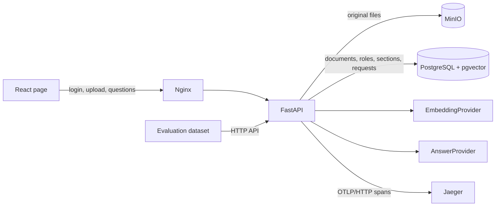

# Enterprise Knowledge Assistant

A single-page RAG assistant for an entirely **synthetic** set of enterprise documents. Administrators upload files and assign readable roles; authenticated users ask questions and receive source-backed answers or an explicit abstention. The same page includes document status and request statistics.

## How it works

Retrieval-Augmented Generation (RAG) retrieves relevant passages before producing an answer from them. This application uses **extractive** answering: the local answer provider returns a sentence present in an authorized document. It does not call a hosted LLM or require a paid API. The provider boundary allows a hosted model to be added without changing the upload, retrieval, or authorization contract.



| Technology | Responsibility | Implementation |
|---|---|---|
| Python 3.12, FastAPI, Pydantic, Uvicorn | Typed REST API, input validation, upload, application lifespan | [backend/app/main.py](backend/app/main.py) |
| PostgreSQL 16, psycopg 3 | Documents, roles, sections, request metrics, transactions | [backend/app/storage.py](backend/app/storage.py) |
| pgvector | 128-dimensional vectors and cosine-distance retrieval | [backend/app/main.py](backend/app/main.py) |
| MinIO and its Python SDK | Original-file storage through an S3-compatible API | [backend/app/storage.py](backend/app/storage.py) |
| pypdf | Text extraction from PDFs that contain selectable text | [backend/app/storage.py](backend/app/storage.py) |
| PyJWT | Signed bearer tokens for the local accounts | [backend/app/security.py](backend/app/security.py) |
| React 19, TypeScript, Vite | State, forms, and typed API responses on one page | [frontend/src/App.tsx](frontend/src/App.tsx) |
| Nginx | Static frontend hosting and `/api/` reverse proxy | [frontend/nginx.conf](frontend/nginx.conf) |
| Docker Compose | Reproducible startup, health checks, volumes, service network | [compose.yaml](compose.yaml) |
| OpenTelemetry, OTLP/HTTP, Jaeger | Traces for RAG stages without question or document text | [backend/app/telemetry.py](backend/app/telemetry.py) |
| pytest, Ruff, GitHub Actions | Integration tests, linting, and CI | [backend/tests](backend/tests), [.github/workflows/ci.yml](.github/workflows/ci.yml) |

### From upload to answer

1. **Upload:** An administrator sends a file, title, and readable roles in a multipart request. The API checks the role, extension, 1 MB size limit, and extractable text.
2. **Original and sections:** MinIO stores the file under a UUID-based key. The backend reads UTF-8 Markdown or text, or extracts PDF text with pypdf. Markdown headings become citation anchors; long paragraphs are split into chunks of at most 900 characters.
3. **Indexing:** Each section receives a local 128-dimensional embedding and is stored with its document ID, order, heading, and text. The status changes from `indexing` to `ready` only after the sections are inserted.
4. **Authentication and limits:** A signed JWT identifies the user and role. Before retrieval, the API checks the recent request count and estimated cost budgets.
5. **Authorized retrieval:** SQL selects only `ready` documents visible to that role (administrators can read all documents), sorts their sections by pgvector cosine distance, and returns up to eight candidates.
6. **Grounded answer:** The local provider looks for a sentence with sufficient term overlap. It returns that sentence as both answer and citation quote, including the document title and section. Without sufficient evidence, it returns an abstention with no citations.
7. **Measurement:** The backend records latency, estimated cost, and abstention. OpenTelemetry spans cover embedding, retrieval, and answer selection. The returned `trace_id` links the request to Jaeger.

The role predicate filters **candidate sources before answer selection**. Unauthorized sections never enter the answer provider's context. [Architecture details](docs/architecture.md) describe the data flow.

## Run locally

Docker with Compose v2 is required. From the repository root:

```bash
cp .env.example .env
docker compose up --build -d --wait
```

Open **http://localhost:5173**. Select `employee`, `hr`, `finance`, or `admin` and use the corresponding password from `.env`. The API documentation is at **http://localhost:8000/docs**, MinIO's console at **http://localhost:9001**, and Jaeger at **http://localhost:16686**. Host ports bind to `127.0.0.1` only.

On an empty database, the application imports three synthetic files from `data/`. Administrators can upload Markdown, UTF-8 text, or PDFs with extractable text, up to 1 MB. Scanned PDFs without OCR are rejected. Seed files load only when the documents table is empty.

Stop the services with `docker compose down`. To discard local volumes and reload the initial corpus, run `docker compose down -v` before starting again.

### Configuration

Copy `.env.example` to `.env`; the latter is ignored by Git. The example values are public local defaults and must be replaced before any external exposure.

| Variable | Purpose |
|---|---|
| `POSTGRES_PASSWORD` | Password for the `knowledge` database |
| `MINIO_ROOT_USER`, `MINIO_ROOT_PASSWORD` | Credentials for local S3-compatible storage |
| `JWT_SECRET` | Bearer-token signing key |
| `ADMIN_PASSWORD`, `HR_PASSWORD`, `FINANCE_PASSWORD`, `EMPLOYEE_PASSWORD` | Passwords for the four local accounts |
| `MAX_REQUESTS_PER_MINUTE` | Maximum questions per account in the preceding minute |
| `MAX_REQUEST_COST_USD`, `MAX_DAILY_COST_USD` | Estimated per-request and daily cost ceilings |
| `ESTIMATED_USD_PER_1K_TOKENS` | Assumed cost per thousand tokens; `0` for the local provider |
| `OTEL_EXPORTER_OTLP_ENDPOINT` | Jaeger's OTLP/HTTP endpoint |

The host exposes ports `5173` (web), `8000` (API), `9001` (MinIO console), `16686` (Jaeger), and `5432` (PostgreSQL), all on `127.0.0.1`. MinIO's S3 API on port `9000` stays within the Compose network.

### End-to-end flow

1. As **Employee**, ask "What is the nightly hotel limit?" The answer cites *Travel and Expense Policy → Accommodation*.
2. As **HR**, ask when a parental leave request is due. The source is *People Handbook → Parental leave*.
3. Ask the same question as **Employee**. The HR handbook is unavailable, so the assistant abstains.
4. As **Admin**, upload a synthetic document, assign readable roles, and inspect its status, sections, and request statistics on the same page.
5. In Jaeger, inspect `enterprise-knowledge-api` to see ingestion, embedding, retrieval, and answer spans without question or document text.

Run `bash scripts/run-flow.sh` to execute upload → question → statistics through HTTP using credentials from `.env`.

## Tests and evaluation

With the stack running:

```bash
docker compose exec -T api pytest -q tests
docker compose exec -T api ruff check app tests
python3 scripts/evaluate.py
```

Integration tests cover upload, indexing, role separation, section citations, and abstention. [data/questions.json](data/questions.json) contains expected answers and two unanswerable cases. Evaluation reports:

| Metric | Definition |
|---|---|
| Citation correctness | Expected fact, document, and section match; the quote equals the answer sentence |
| Correct abstention | No attributed answer or citation for an unsupported or unauthorized question |
| Latency | Mean and p95 API response times |
| Estimated cost | Sum of configured token-price estimates; the local default is $0 |

GitHub Actions builds the stack and runs lint, tests, and evaluation on pushes and pull requests. The workflow prints service logs on failure and removes its volumes afterward. Evaluation output lists each case and the aggregate metrics.

## Data model and design choices

### Separate original files from the retrieval index

MinIO stores original bytes. PostgreSQL stores what the application needs to authorize, search, and cite. `documents` holds the ID, title, filename, object key, roles, and status. `sections` holds order, heading, text, and embedding, with a foreign key to its document. `requests` holds operational metadata only. The UUID in the MinIO key associates the object with its SQL record without relying on the filename.

The two storage systems do not share a transaction. If a database write fails after an upload, an orphaned MinIO object may remain. A production system would need periodic cleanup or a compensating workflow.

### Enforce access in SQL

FastAPI's `current_user` and `admin_user` dependencies protect routes before application logic runs. Reading a document by ID checks the role again. Retrieval applies the predicate in the database:

```sql
SELECT s.document_id, d.title, s.heading, s.content
FROM sections AS s
JOIN documents AS d ON d.id = s.document_id
WHERE d.status = 'ready'
  AND (:role = ANY(d.roles) OR :role = 'admin')
ORDER BY s.embedding <=> :question_vector
LIMIT 8;
```

This excerpt shows the logic; the implementation binds values through psycopg `%s` parameters. pgvector's `<=>` is cosine distance, so smaller values rank first. Search is exact: the initial corpus is small, and the access predicate remains easy to inspect. The schema has a GIN index on `roles`, but the current `= ANY(...)` predicate does not assume the planner will use it. Larger corpora require measured query plans, recall, and approximate-index tradeoffs.

Foreign keys prevent orphaned sections. A transaction inserts the sections and changes status to `ready` together. If indexing fails, a separate transaction marks the document `failed`. The schema and bucket are created if absent; the initial documents load only when the table is empty.

### Provider boundaries and grounding

`EmbeddingProvider` and `AnswerProvider` are Python `Protocol` interfaces. Ingestion and `/api/ask` depend on those contracts; [backend/app/rag.py](backend/app/rag.py) wires the concrete local providers. This small **ports and adapters** boundary permits a hosted LLM or embedding service without changing the HTTP contract, data model, or role filter.

`HashEmbedding` applies signed feature hashing: it normalizes words, removes stopwords, assigns each term a SHA-256-derived vector position, and normalizes the 128-dimensional result. Documents and questions share that space. It is not a trained semantic embedding: synonyms may remain far apart. Changing provider or dimension requires re-indexing; the dimension is part of the `vector(128)` schema.

`ExtractiveAnswer` compares question terms with sentences in the retrieved sections. It requires at least two shared terms when possible and a minimum 55% term coverage. A passing sentence becomes both the answer and citation quote. Otherwise the provider says "I can't answer from the available sources" and returns no citation. This is a transparent grounding rule, not a general guarantee against incorrect answers.

### Authentication and single-page state

`/api/login` accepts the FastAPI password-flow form and issues an HS256 JWT valid for eight hours. It includes username, role, and expiry. The application has four fixed accounts (`admin`, `hr`, `finance`, `employee`), with passwords and the signing key read from environment variables. This is role-based access control (RBAC), not an enterprise identity provider. Administrators upload and inspect all documents and statistics; other roles see only assigned documents.

The frontend does not embed passwords. Switching roles clears the local session and requires a new login. API authorization remains authoritative regardless of which controls the page shows. React stores session, selected role, question, answer, visible documents, statistics, and errors in component state. Typed API response shapes (`Answer`, `Citation`, `Document`, `Stats`) keep the single page coherent. Vite builds the frontend; Nginx serves it and proxies `/api/`.

### Observability and limits without content logging

OpenTelemetry creates spans for `document.ingest`, `rag.answer`, `rag.embed`, `rag.retrieve`, and `rag.generate`. The Python OTLP/HTTP exporter sends them to Jaeger. Span attributes include counts, sizes, role, and abstention status, never questions, answers, or document text. HTTP logs contain method, route template, status, and duration. The `requests` table feeds admin totals, abstentions, average and p95 latency, estimated cost, and document status counts.

Per-account request frequency, per-request estimated cost, and daily estimated cost are configurable in `.env`. Token usage is estimated as `(question characters + 1200) / 4`, multiplied by the configured price per thousand tokens. The local default price is zero. These values are estimates, not provider invoices; the rate and budget checks are not atomic under high concurrency.

## Limitations

Accounts are fixed and default passwords are public. Change `.env` before exposing any service. Enterprise authentication, user administration, and secret rotation are outside the current scope. Synchronous indexing keeps `ready` immediately meaningful but would need a queue and retries for larger workloads. PDF chunks do not retain page numbers, and there is no OCR. Lexical matching can abstain on synonyms or complex paraphrases. The SQL budget check does not reserve spend atomically. Untrusted files would require parser isolation, malware scanning, and additional controls.

The pinned MinIO image is a community build from [coollabsio/minio](https://github.com/coollabsio/minio). Its provenance and maintenance should be reviewed before a production deployment.

## API

Interactive OpenAPI documentation is available at `http://localhost:8000/docs`.

| Endpoint | Purpose | Access |
|---|---|---|
| `POST /api/login` | Form username and password; returns an eight-hour token | Public |
| `GET /api/me` | Current identity and role | Authenticated |
| `POST /api/documents` | Upload `file`, `title`, and comma-separated `roles`; index sections | Admin |
| `GET /api/documents` | List visible documents and indexing status | Authenticated |
| `GET /api/documents/{id}` | Read authorized document sections | Authenticated |
| `POST /api/ask` | Question → answer, citations, abstention, latency, estimated cost, trace ID | Authenticated |
| `GET /api/admin/stats` | Request, cost, latency, and document-status aggregates | Admin |
| `GET /health` | Compose health check | Local public |

## Adding a hosted provider

Implement `EmbeddingProvider` and `AnswerProvider` and wire them in `backend/app/rag.py`. Keep `vector(128)` only if the new embedding has the same dimension and compatible representation; otherwise migrate the schema and re-index every section. Put provider credentials and prices in environment variables. Expand the evaluation dataset with paraphrases and harder abstention cases.

A generative adapter must receive only authorized sections. Validate that every returned citation points to a retrieved section and that each answer claim has source support. The current lexical check is insufficient for unconstrained generation; prompt injection in documents, citation validation, and calibrated abstention thresholds need explicit evaluation.

## Repository map

1. [data](data) contains the invented corpus and expected-answer dataset.
2. [backend/app/rag.py](backend/app/rag.py) defines provider interfaces, local retrieval features, answer selection, and text chunking.
3. [backend/app/storage.py](backend/app/storage.py) handles SQL, MinIO, and indexing.
4. [backend/app/security.py](backend/app/security.py) and [backend/app/main.py](backend/app/main.py) implement authentication, authorization, and the API.
5. [frontend/src/App.tsx](frontend/src/App.tsx) connects those flows on one page.
6. [backend/tests](backend/tests), [scripts/evaluate.py](scripts/evaluate.py), and [CI](.github/workflows/ci.yml) verify behavior.

## References

The underlying APIs and concepts are documented by [FastAPI](https://fastapi.tiangolo.com/), [React](https://react.dev/), [PostgreSQL 16](https://www.postgresql.org/docs/16/), [pgvector](https://github.com/pgvector/pgvector), [MinIO Python SDK](https://github.com/minio/minio-py), [Docker Compose](https://docs.docker.com/compose/), [OpenTelemetry Python](https://opentelemetry.io/docs/languages/python/), and [GitHub Actions](https://docs.github.com/en/actions).
