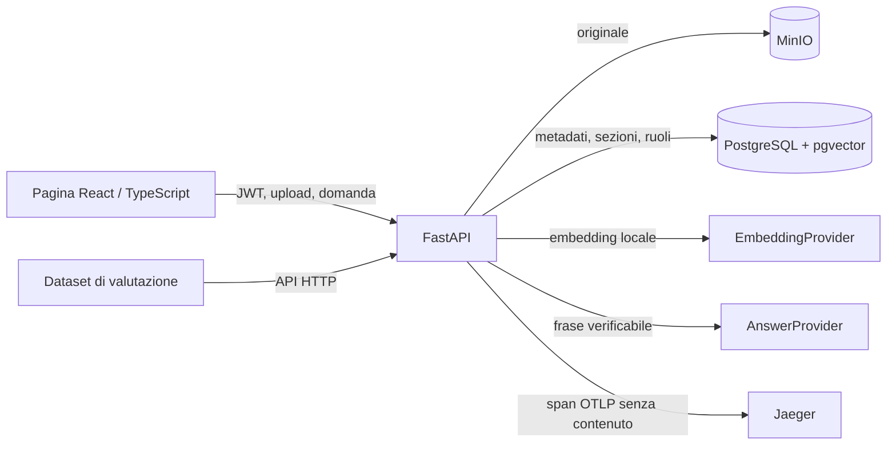

# Architettura

## Ingestione

1. L'amministratore seleziona il file e assegna uno o più ruoli.
2. L'API valida dimensione, tipo e testo estraibile. L'originale va in MinIO con una chiave UUID.
3. Il parser divide Markdown e testo sui titoli; i PDF in paragrafi. Il limite di 900 caratteri mantiene i segmenti piccoli e citabili.
4. Un embedding deterministico a 128 dimensioni è salvato nella colonna `vector(128)` di pgvector. Lo stato `ready` viene impostato dopo l'inserimento delle sezioni.

## Domanda

1. Il token firmato identifica il ruolo. Il backend controlla frequenza e budget stimato.
2. La query SQL unisce sezioni e documenti, impone `role = ANY(documents.roles)` (o il ruolo amministratore) e ordina le sole sezioni ammesse con la distanza coseno `<=>`.
3. Il provider locale sceglie una frase del corpus con sufficiente sovrapposizione lessicale. Restituisce la stessa frase come risposta e citazione.
4. Se non esiste evidenza sufficiente, il provider restituisce un'astensione e nessuna citazione.
5. Il backend salva solo ruolo, latenza, astensione e costo stimato; OpenTelemetry registra solo conteggi e stati delle fasi.

La ricerca esatta senza indice ANN è deliberata: su tre documenti sintetici è più facile verificare che il filtro di accesso preceda l'ordinamento. Su un corpus grande servirebbero indici, benchmark e una strategia di filtro e recall misurata.
