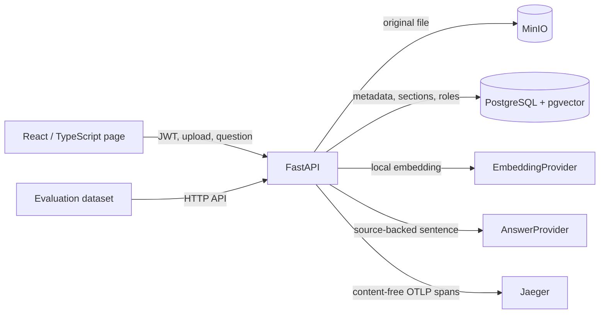

# Architecture

## Ingestion

1. An administrator selects a file and assigns one or more readable roles.
2. The API validates its size, type, and extractable text. MinIO stores the original under a UUID-based key.
3. The parser splits Markdown and text at headings and PDFs at paragraph boundaries. The 900-character limit keeps sections small enough to cite.
4. A deterministic 128-dimensional embedding is stored in a pgvector `vector(128)` column. The status changes to `ready` only after sections are inserted.

## Question answering

1. A signed token identifies the role. The backend checks request frequency and estimated cost limits.
2. The SQL query joins sections and documents, applies `role = ANY(documents.roles)` (or the administrator role), and orders only authorized sections by cosine distance (`<=>`).
3. The local provider selects a sentence with sufficient lexical overlap and returns the same sentence as the answer and citation quote.
4. If no sentence has enough support, it abstains and returns no citations.
5. The backend stores only role, latency, abstention, and estimated cost. OpenTelemetry spans contain counts and stage status, not document or question text.

Exact search is appropriate for the small synthetic corpus. A larger corpus would require measured index choices, query plans, recall, and the effect of role filtering on retrieval.
